# SAT-J Entity Relationship Diagram

This ERD is derived from the checked-in Supabase migrations. It shows the application’s core tables and declared foreign-key relationships. Supabase `auth.users` is shown as an external identity table. Some operational columns and audit metadata are omitted for readability; polymorphic references are called out after the diagram because they are not database foreign keys.

```mermaid
erDiagram
  AUTH_USERS ||--o| PROFILES : "user id"
  ROLES ||--o{ PROFILES : assigns
  ROLES ||--o{ ROLE_PERMISSIONS : grants
  PERMISSIONS ||--o{ ROLE_PERMISSIONS : contains
  PROFILES ||--o{ USER_BRANCHES : assigned
  BRANCHES ||--o{ USER_BRANCHES : serves
  BRANCHES ||--o{ AUDIT_LOGS : context

  CATEGORIES ||--o{ CATEGORIES : parent
  CATEGORIES ||--o{ PRODUCT_TYPES : classifies
  CATEGORIES ||--o{ CATEGORY_ATTRIBUTES : defines
  ATTRIBUTES ||--o{ CATEGORY_ATTRIBUTES : enabled_for
  ATTRIBUTES ||--o{ ATTRIBUTE_VALUES : offers
  CATEGORIES ||--o{ PRODUCTS : contains
  PRODUCT_TYPES o|--o{ PRODUCTS : optional_type
  BRANDS o|--o{ PRODUCTS : brands
  UNITS_OF_MEASURE ||--o{ PRODUCTS : measured_in
  PRODUCTS ||--|{ PRODUCT_VARIANTS : has
  PRODUCT_VARIANTS ||--o{ VARIANT_ATTRIBUTE_VALUES : configured_by
  ATTRIBUTES ||--o{ VARIANT_ATTRIBUTE_VALUES : describes
  ATTRIBUTE_VALUES o|--o{ VARIANT_ATTRIBUTE_VALUES : selected_value
  PRODUCT_VARIANTS ||--o{ PRODUCT_PRICES : priced
  BRANCHES o|--o{ PRODUCT_PRICES : branch_price
  PRODUCTS ||--o{ PRODUCT_IMAGES : illustrated
  PRODUCT_VARIANTS o|--o{ PRODUCT_IMAGES : variant_image

  BRANCHES ||--o{ BRANCH_INVENTORY : holds
  PRODUCT_VARIANTS ||--o{ BRANCH_INVENTORY : stocked
  BRANCHES ||--o{ STOCK_MOVEMENTS : records
  PRODUCT_VARIANTS ||--o{ STOCK_MOVEMENTS : moves
  BRANCHES ||--o{ BRANCH_INVENTORY_COSTS : values
  PRODUCT_VARIANTS ||--o{ BRANCH_INVENTORY_COSTS : costed
  STOCK_MOVEMENTS ||--o| INVENTORY_COST_EVENTS : cost_event
  BRANCHES ||--o{ INVENTORY_COST_EVENTS : cost_branch
  PRODUCT_VARIANTS ||--o{ INVENTORY_COST_EVENTS : cost_variant
  BRANCHES ||--o{ STOCK_ADJUSTMENTS : adjustment
  STOCK_ADJUSTMENT_REASONS ||--o{ STOCK_ADJUSTMENTS : reason
  STOCK_ADJUSTMENTS ||--|{ STOCK_ADJUSTMENT_ITEMS : lines
  PRODUCT_VARIANTS ||--o{ STOCK_ADJUSTMENT_ITEMS : adjusted
  STOCK_MOVEMENTS o|--o| STOCK_ADJUSTMENT_ITEMS : movement
  BRANCHES ||--o{ STOCK_COUNTS : count
  STOCK_COUNTS ||--|{ STOCK_COUNT_ITEMS : lines
  PRODUCT_VARIANTS ||--o{ STOCK_COUNT_ITEMS : counted
  STOCK_MOVEMENTS o|--o| STOCK_COUNT_ITEMS : movement

  SUPPLIERS ||--o{ PURCHASES : supplies
  BRANCHES ||--o{ PURCHASES : orders_for
  PURCHASES ||--|{ PURCHASE_ITEMS : lines
  PRODUCT_VARIANTS ||--o{ PURCHASE_ITEMS : purchased
  PURCHASES ||--o{ GOODS_RECEIPTS : received_as
  BRANCHES ||--o{ GOODS_RECEIPTS : received_at
  AUTH_USERS ||--o{ GOODS_RECEIPTS : received_by
  GOODS_RECEIPTS ||--|{ GOODS_RECEIPT_ITEMS : lines
  PURCHASE_ITEMS ||--o{ GOODS_RECEIPT_ITEMS : fulfilled
  PRODUCT_VARIANTS ||--o{ GOODS_RECEIPT_ITEMS : received_variant
  STOCK_MOVEMENTS ||--o| GOODS_RECEIPT_ITEMS : posts_movement
  SUPPLIERS ||--o{ SUPPLIER_PAYMENTS : paid
  PURCHASES o|--o{ SUPPLIER_PAYMENTS : settles
  BRANCHES ||--o{ SUPPLIER_PAYMENTS : paid_from_branch
  AUTH_USERS ||--o{ SUPPLIER_PAYMENTS : recorded_by

  CUSTOMERS ||--o{ SALES : buys
  BRANCHES ||--o{ SALES : sells_from
  SALES ||--|{ SALE_ITEMS : lines
  PRODUCT_VARIANTS ||--o{ SALE_ITEMS : sold
  STOCK_MOVEMENTS o|--o| SALE_ITEMS : issue_movement
  STOCK_MOVEMENTS o|--o| SALE_ITEMS : reversal_movement
  CUSTOMERS ||--o{ CUSTOMER_PAYMENTS : pays
  SALES ||--o{ CUSTOMER_PAYMENTS : settles
  BRANCHES ||--o{ CUSTOMER_PAYMENTS : collected_at
  FINANCIAL_ACCOUNTS o|--o{ CUSTOMER_PAYMENTS : collection_account
  AUTH_USERS ||--o{ CUSTOMER_PAYMENTS : recorded_by
  BRANCHES ||--o{ DAILY_SALES_BATCHES : batches
  DAILY_SALES_BATCHES o|--o{ DAILY_SALES_BATCHES : corrects_or_replaces
  AUTH_USERS ||--o{ DAILY_SALES_BATCHES : created_by
  DAILY_SALES_BATCHES ||--|{ DAILY_SALES_BATCH_ITEMS : lines
  PRODUCT_VARIANTS ||--o{ DAILY_SALES_BATCH_ITEMS : sold
  STOCK_MOVEMENTS o|--o| DAILY_SALES_BATCH_ITEMS : issue_movement
  STOCK_MOVEMENTS o|--o| DAILY_SALES_BATCH_ITEMS : reversal_movement

  BRANCHES ||--o{ STOCK_TRANSFERS : source_branch
  BRANCHES ||--o{ STOCK_TRANSFERS : destination_branch
  STOCK_TRANSFERS ||--|{ STOCK_TRANSFER_ITEMS : lines
  PRODUCT_VARIANTS ||--o{ STOCK_TRANSFER_ITEMS : transferred
  STOCK_MOVEMENTS o|--o| STOCK_TRANSFER_ITEMS : dispatch_movement
  STOCK_MOVEMENTS o|--o| STOCK_TRANSFER_ITEMS : receipt_movement

  PUBLIC_SITE_SETTINGS
  BRANCHES o|--o{ QUOTATION_REQUESTS : preferred_branch
  PRODUCTS o|--o{ QUOTATION_REQUESTS : legacy_product_reference
  PRODUCT_VARIANTS o|--o{ QUOTATION_REQUESTS : legacy_variant_reference
  QUOTATION_REQUESTS ||--o{ QUOTATION_REQUEST_ITEMS : requested_products
  PRODUCTS ||--o{ QUOTATION_REQUEST_ITEMS : requested_product

  BRANCHES ||--o{ FINANCIAL_ACCOUNT_BRANCHES : enabled_at
  FINANCIAL_ACCOUNTS ||--o{ FINANCIAL_ACCOUNT_BRANCHES : available_to
  BRANCHES ||--o{ EXPENSES : incurs
  EXPENSE_CATEGORIES ||--o{ EXPENSES : classifies
  AUTH_USERS ||--o{ EXPENSES : created_by
  AUTH_USERS o|--o{ EXPENSES : approved_by
  EXPENSES ||--o{ EXPENSE_PAYMENTS : paid_in_parts
  BRANCHES ||--o{ EXPENSE_PAYMENTS : paid_from_branch
  FINANCIAL_ACCOUNTS ||--o{ EXPENSE_PAYMENTS : paid_from_account
  AUTH_USERS ||--o{ EXPENSE_PAYMENTS : recorded_by
  FINANCIAL_ACCOUNTS ||--o{ FINANCIAL_MOVEMENTS : ledger
  BRANCHES ||--o{ FINANCIAL_MOVEMENTS : ledger_branch
  AUTH_USERS ||--o{ FINANCIAL_MOVEMENTS : recorded_by
  FINANCIAL_ACCOUNTS ||--o{ FINANCIAL_ACCOUNT_OPENINGS : opened
  BRANCHES ||--o{ FINANCIAL_ACCOUNT_OPENINGS : opening_branch
  FINANCIAL_ACCOUNTS ||--o{ FINANCIAL_RECONCILIATIONS : reconciled
  BRANCHES ||--o{ FINANCIAL_RECONCILIATIONS : reconciliation_branch
  AUTH_USERS ||--o{ FINANCIAL_RECONCILIATIONS : reconciled_by

  AUTH_USERS {
    uuid id PK
  }
  ROLES {
    uuid id PK
    text name
  }
  PERMISSIONS {
    uuid id PK
    text code
  }
  ROLE_PERMISSIONS {
    uuid role_id FK
    uuid permission_id FK
  }
  PROFILES {
    uuid id PK, FK
    uuid role_id FK
    text full_name
    text email
  }
  BRANCHES {
    uuid id PK
    text name
    text code
  }
  USER_BRANCHES {
    uuid user_id PK, FK
    uuid branch_id PK, FK
  }
  AUDIT_LOGS {
    uuid id PK
    uuid branch_id FK
    text entity_type
    uuid entity_id
  }
  CATEGORIES {
    uuid id PK
    uuid parent_id FK
    text name
    text slug
  }
  PRODUCT_TYPES {
    uuid id PK
    uuid category_id FK
    text name
  }
  BRANDS {
    uuid id PK
    text name
  }
  UNITS_OF_MEASURE {
    uuid id PK
    text name
    text symbol
  }
  ATTRIBUTES {
    uuid id PK
    text name
    text data_type
  }
  ATTRIBUTE_VALUES {
    uuid id PK
    uuid attribute_id FK
    text value
  }
  CATEGORY_ATTRIBUTES {
    uuid category_id PK, FK
    uuid attribute_id PK, FK
  }
  PRODUCTS {
    uuid id PK
    uuid category_id FK
    uuid product_type_id FK
    uuid brand_id FK
    uuid unit_of_measure_id FK
    text name
    text size
    text colour
  }
  PRODUCT_VARIANTS {
    uuid id PK
    uuid product_id FK
    text sku
    text name
  }
  VARIANT_ATTRIBUTE_VALUES {
    uuid variant_id PK, FK
    uuid attribute_id PK, FK
    uuid attribute_value_id FK
  }
  PRODUCT_PRICES {
    uuid id PK
    uuid variant_id FK
    uuid branch_id FK
    text price_type
    numeric amount
  }
  PRODUCT_IMAGES {
    uuid id PK
    uuid product_id FK
    uuid variant_id FK
    text storage_path
  }
  BRANCH_INVENTORY {
    uuid id PK
    uuid branch_id FK
    uuid variant_id FK
    numeric quantity_on_hand
  }
  STOCK_MOVEMENTS {
    uuid id PK
    uuid branch_id FK
    uuid variant_id FK
    text movement_type
    numeric quantity_delta
  }
  STOCK_ADJUSTMENT_REASONS {
    uuid id PK
    text name
  }
  STOCK_ADJUSTMENTS {
    uuid id PK
    uuid branch_id FK
    uuid reason_id FK
    text status
  }
  STOCK_ADJUSTMENT_ITEMS {
    uuid id PK
    uuid adjustment_id FK
    uuid variant_id FK
    uuid stock_movement_id FK
  }
  STOCK_COUNTS {
    uuid id PK
    uuid branch_id FK
    text status
  }
  STOCK_COUNT_ITEMS {
    uuid id PK
    uuid stock_count_id FK
    uuid variant_id FK
    uuid stock_movement_id FK
  }
  SUPPLIERS {
    uuid id PK
    text name
    text code
  }
  PURCHASES {
    uuid id PK
    uuid supplier_id FK
    uuid branch_id FK
    text purchase_number
  }
  PURCHASE_ITEMS {
    uuid id PK
    uuid purchase_id FK
    uuid variant_id FK
    numeric quantity
  }
  GOODS_RECEIPTS {
    uuid id PK
    uuid purchase_id FK
    uuid branch_id FK
    uuid received_by FK
  }
  GOODS_RECEIPT_ITEMS {
    uuid id PK
    uuid goods_receipt_id FK
    uuid purchase_item_id FK
    uuid variant_id FK
    uuid stock_movement_id FK
  }
  SUPPLIER_PAYMENTS {
    uuid id PK
    uuid supplier_id FK
    uuid purchase_id FK
    uuid branch_id FK
    numeric amount
  }
  CUSTOMERS {
    uuid id PK
    text name
    text code
  }
  SALES {
    uuid id PK
    uuid branch_id FK
    uuid customer_id FK
    text sale_number
  }
  SALE_ITEMS {
    uuid id PK
    uuid sale_id FK
    uuid variant_id FK
    uuid stock_movement_id FK
    numeric quantity
    numeric cost_total_snapshot
  }
  CUSTOMER_PAYMENTS {
    uuid id PK
    uuid customer_id FK
    uuid sale_id FK
    uuid branch_id FK
    uuid financial_account_id FK
    numeric amount
  }
  DAILY_SALES_BATCHES {
    uuid id PK
    uuid branch_id FK
    uuid correction_of_batch_id FK
    uuid replacement_batch_id FK
    text status
  }
  DAILY_SALES_BATCH_ITEMS {
    uuid id PK
    uuid batch_id FK
    uuid variant_id FK
    uuid stock_movement_id FK
    numeric quantity
    numeric cost_total_snapshot
  }
  STOCK_TRANSFERS {
    uuid id PK
    uuid source_branch_id FK
    uuid destination_branch_id FK
    text status
  }
  STOCK_TRANSFER_ITEMS {
    uuid id PK
    uuid transfer_id FK
    uuid variant_id FK
    uuid transfer_out_movement_id FK
    uuid transfer_in_movement_id FK
  }
  PUBLIC_SITE_SETTINGS {
    uuid id PK
    text site_name
  }
  QUOTATION_REQUESTS {
    uuid id PK
    uuid preferred_branch_id FK
    uuid product_id FK
    uuid variant_id FK
    text status
  }
  QUOTATION_REQUEST_ITEMS {
    uuid id PK
    uuid quotation_request_id FK
    uuid product_id FK
    numeric quantity
  }
  BRANCH_INVENTORY_COSTS {
    uuid branch_id PK, FK
    uuid variant_id PK, FK
    numeric inventory_value
    numeric weighted_average_cost
    text cost_status
  }
  INVENTORY_COST_EVENTS {
    uuid id PK
    uuid stock_movement_id FK
    uuid branch_id FK
    uuid variant_id FK
    numeric value_delta
    text source
  }
  EXPENSE_CATEGORIES {
    uuid id PK
    text code
    text name
  }
  FINANCIAL_ACCOUNTS {
    uuid id PK
    text code
    text account_type
  }
  FINANCIAL_ACCOUNT_BRANCHES {
    uuid account_id PK, FK
    uuid branch_id PK, FK
  }
  EXPENSES {
    uuid id PK
    uuid branch_id FK
    uuid category_id FK
    text status
    numeric amount
  }
  EXPENSE_PAYMENTS {
    uuid id PK
    uuid expense_id FK
    uuid branch_id FK
    uuid account_id FK
    numeric amount
  }
  FINANCIAL_MOVEMENTS {
    uuid id PK
    uuid account_id FK
    uuid branch_id FK
    text movement_kind
    text direction
    numeric amount
    text reference_type
    uuid reference_id
  }
  FINANCIAL_ACCOUNT_OPENINGS {
    uuid account_id PK, FK
    uuid branch_id PK, FK
    uuid operation_key UK
  }
  FINANCIAL_RECONCILIATIONS {
    uuid id PK
    uuid account_id FK
    uuid branch_id FK
    date statement_date
    numeric variance
  }
```

## Notes

- `financial_movements.reference_type` and `reference_id` form a polymorphic link to a customer payment, supplier payment, expense payment, opening, or adjustment. There is intentionally no single foreign key for that pair.
- User/employee references are shown against Supabase `auth.users`; `profiles.id` is the application profile row for that auth identity.
- Daily-sales batch items and normal sale items are distinct ways inventory can be sold; both post stock movements and carry cost snapshots.
- Document number sequence tables are omitted from the main diagram because they are counters rather than business entities. They include inventory, purchasing, sales, transfers, quotations, daily sales, and expenses.
- To render this file, use any Mermaid-compatible Markdown viewer. The diagram source is editable in `docs/sat-j-erd.md`.
